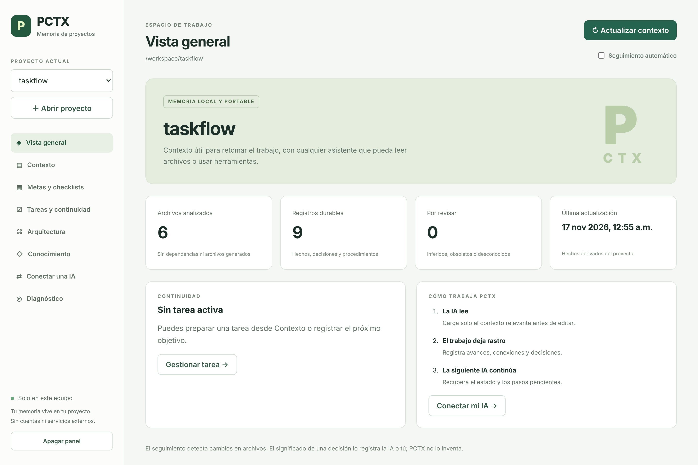
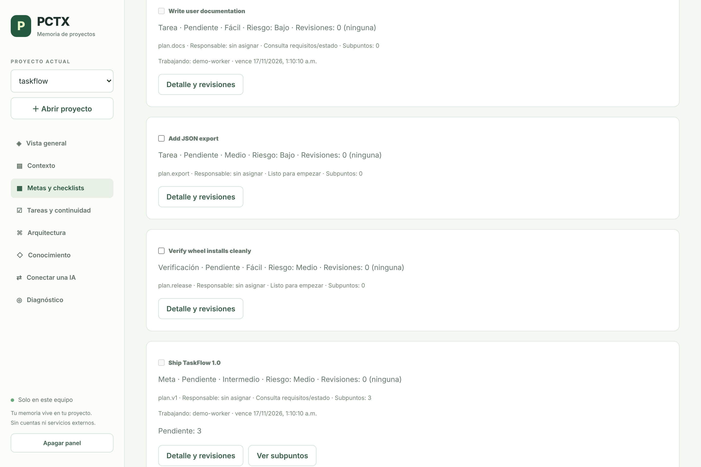

<div align="center">
  
  <h1>PCTX</h1>
  <p><strong>Memoria de proyecto portable y respaldada por evidencia para asistentes de IA.</strong></p>
  <p>
    <a href="README.md">English</a> ·
    <a href="#inicio-rápido">Inicio rápido</a> ·
    <a href="#mcp">MCP</a> ·
    <a href="docs/README.md">Documentación</a>
  </p>
  <p>
    <a href="https://www.python.org/downloads/"></a>
    <a href="LICENSE"></a>
    <a href="docs/INTEGRACIONES.md"></a>
    
  </p>
</div>

PCTX compila el conocimiento durable de un proyecto — hechos, decisiones,
restricciones, procedimientos, fallos confirmados y traspasos — en un archivo de
contexto portable y en paquetes pequeños por tarea. Cualquier asistente puede
retomar el trabajo sin releer todo el repositorio ni reproducir una conversación.

Funciona en local, **sin dependencias de ejecución** y guarda *por qué* se cree
cada afirmación: estado, origen, evidencia, vigencia y sensibilidad.



## ¿Por qué otra herramienta de contexto?

La mayoría de la "memoria" para agentes de código es un Markdown gigante que se
queda obsoleto, o un registro de chat que no se puede auditar. PCTX mantiene un
almacén pequeño de registros tipados y compila solo lo relevante:

- **Evidencia, no intuiciones.** Cada registro tiene estado (`verified`,
  `user_asserted`, `inferred`, `stale`, `superseded`), origen y evidencia. Lo
  volátil caduca; los reemplazos conservan el historial.
- **Encaja con cualquier asistente.** Markdown y JSON simples, servidor MCP por
  stdio y adaptadores para `AGENTS.md`, `CLAUDE.md`, `GEMINI.md`, Copilot,
  Cursor y Windsurf.
- **Pensado para varios agentes a la vez.** Metas y checklists con dificultad y
  riesgo, reservas cooperativas de tareas y rutas con TTL, checkpoints y
  traspasos.
- **Local y aburrido a propósito.** Sin cuentas, red, telemetría ni embeddings
  obligatorios; el contenido con pinta de secreto se rechaza antes de guardarse.

## Inicio rápido

Requiere Python 3.10+ y SQLite con FTS5 (incluido en las builds de CPython).

```bash
# Instalación aislada desde este repositorio
pipx install git+https://github.com/tuangel134/pctx.git

# Dentro del proyecto que quieres dotar de memoria
cd ~/proyectos/mi-app
pctx init
pctx scan
pctx export
pctx doctor
```

Esto genera:

| Ruta | Propósito |
| --- | --- |
| `PROJECT_CONTEXT.md` | Contexto exportado, legible por personas y LLMs |
| `architecture.md` | Mapa Mermaid compacto de componentes e imports |
| `TASKS.md` | Marcador de recuperación de la tarea activa |
| `.project-context/` | Registros JSON canónicos y estado local de la máquina |

Pide solo lo que necesita una tarea, dentro de un presupuesto de tokens:

```bash
pctx context --task "añadir recuperación de contraseña sin romper la API" --budget 8000
pctx brief --budget 800 --role W4
```

Registra conocimiento durable:

```bash
pctx decision \
  --id decision.storage \
  --statement "Las sesiones se guardan en PostgreSQL" \
  --rationale "Las migraciones y tests existentes ya dependen de él"

pctx record --type constraint --id constraint.no-secrets \
  --statement "Nunca guardar secretos ni valores de .env en la memoria del proyecto" \
  --state user_asserted --export
```

## Cómo funciona

```text
archivos del proyecto ──► escaneo estático ──► registros tipados ──► contexto compilado
                                                    │                       │
                                       decisiones, evidencia,      PROJECT_CONTEXT.md
                                       TTL, reemplazos,            paquetes por tarea,
                                       checklists, reservas        briefs
```

1. **Scan** inspecciona manifiestos, estado de Git, estructura y hashes. Nunca
   ejecuta el código del proyecto.
2. **Los registros** son documentos JSON pequeños con ID estable. Los estados
   nuevos reemplazan a los antiguos sin borrar historial; `--ttl` caduca
   afirmaciones volátiles.
3. **Compile** produce una exportación portable, un brief por rol o un paquete
   por tarea que cabe en un presupuesto de tokens.
4. **Verify** puede ejecutar una comprobación registrada y guardar el resultado
   observado — nunca de forma automática, solo si se solicita.

### Estados de un registro

| Estado | Significado |
| --- | --- |
| `verified` | Respaldado por evidencia vigente (hash, revisión de Git, check) |
| `user_asserted` | Declarado por una persona o una decisión explícita |
| `inferred` | Escrito por una IA o importado de un informe; requiere revisión |
| `stale` | La evidencia cambió o caducó; revisar antes de confiar |
| `superseded` | Reemplazado por un registro más nuevo; se conserva |
| `unknown` | Información insuficiente |

## MCP

PCTX habla MCP por stdio. Genera la configuración del cliente:

```bash
pctx --root /ruta/al/proyecto integrate --client vscode --write
pctx --root /ruta/al/proyecto integrate --client cursor --write
pctx --root /ruta/al/proyecto integrate --client claude-code --write
```

O añádelo a mano:

```json
{
  "mcpServers": {
    "pctx": {
      "command": "pctx",
      "args": ["--root", "/ruta/al/proyecto", "mcp", "serve", "--allow-write"]
    }
  }
}
```

- `mcp serve` es de solo lectura por defecto. Con `--allow-write` el agente puede
  registrar decisiones, checkpoints y traspasos; con `--watch` se refresca la
  memoria derivada mientras el cliente mantiene el servidor abierto.
- El servidor expone herramientas de contexto, búsqueda, plan, coordinación e
  historial, además de recursos de contexto/arquitectura/tareas.
- El comportamiento del cliente no está garantizado: `pctx diagnose` comprueba
  el protocolo, no si un modelo decide usar las herramientas.

## Varias IAs a la vez

PCTX no invoca ni contrata modelos. Da a las sesiones que cooperan un protocolo
compartido y auditable:

```bash
# Crea una meta y tareas con dificultad y riesgo explícitos
pctx plan create --id plan.login --kind goal --title "Entregar el login" \
  --difficulty intermediate --difficulty-reason "Toca API, UI y sesiones" --risk high
pctx plan create --id plan.login-api --parent plan.login --kind task \
  --title "Implementar el endpoint de login" --difficulty medium \
  --difficulty-reason "Una ruta y sus tests" --risk medium

# Reserva la tarea y las rutas exactas antes de editar
pctx coordinate claim --session-id ia-login-01 --task-id plan.login-api \
  --path src/auth --path tests/auth --ttl 900

pctx coordinate list --status active --budget 1500
pctx coordinate renew --id <lease-id> --ttl 900
pctx coordinate release --id <lease-id> --summary "Endpoint hecho; faltan tests"
```

Las reservas son **leases cooperativas**, no bloqueos del sistema operativo: los
editores siguen funcionando, pero cada sesión debe respetar el protocolo. Una
reserva vencida deja de ocupar la zona y un trabajador tardío no puede pisar a su
sucesor en silencio.



## Recuperación

La búsqueda es local con SQLite FTS5 sobre registros y documentos, con
presupuestos y evidencia expandible:

```bash
pctx lookup "flujo de autenticación" --budget 2000
pctx expand <id-de-registro-o-fragmento> --budget 1200
pctx neighbors <id-de-registro> --budget 1000
```

La búsqueda semántica es opcional y totalmente local: PCTX nunca descarga
modelos ni llama a una API. Instala el extra y apunta a un bundle ONNX:

```bash
pipx inject pctx numpy onnxruntime tokenizers   # o: pip install -e ".[semantic]"
pctx index --model /ruta/al/bundle-onnx
pctx lookup "¿cómo funciona el login?" --mode hybrid --model /ruta/al/bundle-onnx
```

Los JSON siguen siendo la fuente de verdad; los índices son desechables y las
consultas no se guardan.

## Instalación

```bash
# Instalación aislada desde Git
pipx install git+https://github.com/tuangel134/pctx.git

# O como checkout editable / biblioteca
git clone https://github.com/tuangel134/pctx.git
cd pctx
python3 -m pip install -e ".[dev]"
```

Entrada de escritorio en Linux (menú de aplicaciones + `~/.local/bin/pctx`):

```bash
python3 install.py
```

Otras plataformas funcionan con `pip`/`pipx`, pero aún no se validan de forma
continua. El panel es una interfaz web local que se abre con `pctx gui`.

## CLI de un vistazo

| Comando | Qué hace |
| --- | --- |
| `pctx init` / `scan` | Crear memoria y refrescar hechos verificados |
| `pctx export` | Compilar `PROJECT_CONTEXT.md` |
| `pctx context --task` | Construir un paquete de contexto por tarea |
| `pctx brief` | Brief corto: objetivo, siguiente paso, restricciones, bloqueos |
| `pctx record` / `decision` | Añadir conocimiento durable |
| `pctx handoff` | Guardar, verificar o retomar un traspaso |
| `pctx task` | Iniciar, dejar checkpoint o cerrar trabajo reanudable |
| `pctx plan` | Metas, checklists, dificultad, riesgo y revisiones |
| `pctx coordinate` | Reservas cooperativas de tareas y rutas |
| `pctx verify` | Previsualizar o ejecutar una comprobación registrada |
| `pctx lookup` / `expand` / `neighbors` | Recuperación con presupuesto |
| `pctx mcp serve` | Servidor MCP por stdio |
| `pctx integrate` | Escribir la configuración MCP de un cliente |
| `pctx adapters sync` | Actualizar `AGENTS.md`, `CLAUDE.md`, etc. |
| `pctx doctor` | Salud, deriva y comprobaciones de seguridad |
| `pctx gui` | Panel local en `127.0.0.1` |
| `pctx backup` / `history` | Respaldos privados y revisiones de registros |

Ayuda completa: `pctx <comando> --help`.

## Seguridad y privacidad

- Todo ocurre en local. El panel escucha en `127.0.0.1` y exige un token por
  sesión; no hay componente en la nube.
- No se guardan conversaciones, razonamiento interno ni salida rutinaria de
  herramientas. `.project-context/.private/` y `.cache/` quedan fuera del control
  de versiones.
- El contenido con pinta de secreto (claves privadas, tokens de proveedores,
  asignaciones de contraseñas) se rechaza antes de escribirse en un registro.
- `scan` no ejecuta el código del proyecto; los comandos de comprobación solo se
  ejecutan con `pctx verify --run` o una petición explícita.
- El contenido del repositorio se trata como **datos**, no como instrucciones con
  autoridad.

## Estado y límites

PCTX es **0.7.1 (beta)** y es explícito sobre lo que no puede hacer:

- El escáner es estático y de mejor esfuerzo; no deduce toda la semántica ni
  garantiza cobertura completa.
- Las reservas coordinan agentes que cooperan; no bloquean editores a nivel de
  sistema operativo.
- `verified` significa que la evidencia estaba vigente y una revisión registrada
  cubrió los criterios, no que exista una auditoría independiente.
- El panel está solo en español; la CLI, el contexto generado y las herramientas
  MCP están en inglés.
- La ruta probada es Python 3.10+ en Linux. Windows y macOS necesitan validación.

## Documentación

- [Guía de uso](docs/GUIA_USO.md) · [flujo 0.7](docs/USO_0.7.md) ·
  [correcciones 0.7.1](docs/USO_0.7.1.md)
- [Integraciones y MCP Master](docs/INTEGRACIONES.md)
- [Metas y checklists](docs/CHECKLISTS_0.5.md) ·
  [coordinación entre IAs](docs/COORDINACION_0.6.md)
- [Recuperación y embeddings locales](docs/RECUPERACION_0.4.md)
- [Cambios](CHANGELOG.md) · [historial de validación](docs/README.md)

## Contribuir

Se agradecen informes de bugs, ejemplos reproducibles y pull requests acotados.
Consulta [CONTRIBUTING.md](CONTRIBUTING.md). Antes de enviar cambios:

```bash
python3 -m pip install -e ".[dev]"
python3 -m pytest -q
```

## Licencia

MIT — ver [LICENSE](LICENSE). PCTX no está afiliado a Anthropic, OpenAI, Google
ni a ningún fabricante de editores.
