<!-- pctx:architecture:start -->
# Architecture map

> Generated by PCTX from static project structure and recorded connections. Keep durable manual notes outside this managed block.

```mermaid
flowchart LR
    component_benchmarks["benchmarks/"]
    component_pctx["pctx/"]
    component_tests["tests/"]
    file_pyproject_toml["pyproject.toml"]
    module_benchmarks_clean_room["benchmarks/clean_room.py"]
    module_benchmarks_incremental["benchmarks/incremental.py"]
    module_benchmarks_knowledge["benchmarks/knowledge.py"]
    module_benchmarks_recovery["benchmarks/recovery.py"]
    module_pctx["pctx/__init__.py"]
    module_pctx___main["pctx/__main__.py"]
    module_pctx_adapters["pctx/adapters.py"]
    module_pctx_architecture["pctx/architecture.py"]
    module_pctx_backup["pctx/backup.py"]
    module_pctx_bridge["pctx/bridge.py"]
    module_pctx_briefing["pctx/briefing.py"]
    module_pctx_cli["pctx/cli.py"]
    module_pctx_compile["pctx/compile.py"]
    module_pctx_continuity["pctx/continuity.py"]
    module_pctx_coordination["pctx/coordination.py"]
    module_pctx_dashboard["pctx/dashboard.py"]
    module_pctx_diagnostics["pctx/diagnostics.py"]
    module_pctx_doctor["pctx/doctor.py"]
    module_pctx_embeddings["pctx/embeddings.py"]
    module_pctx_freshness["pctx/freshness.py"]
    module_pctx_history["pctx/history.py"]
    module_pctx_incremental["pctx/incremental.py"]
    module_pctx_integrations["pctx/integrations.py"]
    module_pctx_knowledge["pctx/knowledge.py"]
    module_pctx_links["pctx/links.py"]
    module_pctx_mcp["pctx/mcp.py"]
    module_pctx_model["pctx/model.py"]
    module_pctx_planning["pctx/planning.py"]
    module_pctx_planning_model["pctx/planning_model.py"]
    module_pctx_portable["pctx/portable.py"]
    module_pctx_public_paths["pctx/public_paths.py"]
    module_pctx_replacement["pctx/replacement.py"]
    module_pctx_retrieval["pctx/retrieval.py"]
    module_pctx_review["pctx/review.py"]
    module_pctx_scan["pctx/scan.py"]
    module_pctx_security["pctx/security.py"]
    module_pctx_service["pctx/service.py"]
    module_pctx_storage["pctx/storage.py"]
    module_pctx_tasks["pctx/tasks.py"]
    module_pctx_verification["pctx/verification.py"]
    module_pctx_web_app["pctx/web/app.js"]
    module_pctx_worker_reports["pctx/worker_reports.py"]
    module_tests_test_backup["tests/test_backup.py"]
    module_tests_test_brief_followup["tests/test_brief_followup.py"]
    module_tests_test_continuity["tests/test_continuity.py"]
    module_tests_test_coordination["tests/test_coordination.py"]
    module_tests_test_diagnostics["tests/test_diagnostics.py"]
    module_tests_test_freshness_workers["tests/test_freshness_workers.py"]
    module_tests_test_history["tests/test_history.py"]
    module_tests_test_incremental["tests/test_incremental.py"]
    module_tests_test_knowledge["tests/test_knowledge.py"]
    module_tests_test_pctx["tests/test_pctx.py"]
    module_tests_test_planning["tests/test_planning.py"]
    module_tests_test_retrieval["tests/test_retrieval.py"]
    module_tests_test_review["tests/test_review.py"]
    module_tests_test_workflows["tests/test_workflows.py"]
    module_tests_wheel_smoke["tests/wheel_smoke.py"]
    pctx_api["Dashboard API loopback"]
    pctx_core["Servicio de memoria y vigilancia"]
    project["project-context"]
    project -->|configures| file_pyproject_toml
    project -->|contains| component_benchmarks
    file_pyproject_toml -->|defines| component_benchmarks
    project -->|contains| component_pctx
    file_pyproject_toml -->|defines| component_pctx
    project -->|contains| component_tests
    file_pyproject_toml -->|defines| component_tests
    component_benchmarks -->|contains| module_benchmarks_clean_room
    component_benchmarks -->|contains| module_benchmarks_incremental
    component_benchmarks -->|contains| module_benchmarks_knowledge
    component_benchmarks -->|contains| module_benchmarks_recovery
    component_pctx -->|contains| module_pctx
    component_pctx -->|contains| module_pctx___main
    component_pctx -->|contains| module_pctx_adapters
    component_pctx -->|contains| module_pctx_architecture
    component_pctx -->|contains| module_pctx_backup
    component_pctx -->|contains| module_pctx_bridge
    component_pctx -->|contains| module_pctx_briefing
    component_pctx -->|contains| module_pctx_cli
    component_pctx -->|contains| module_pctx_compile
    component_pctx -->|contains| module_pctx_continuity
    component_pctx -->|contains| module_pctx_coordination
    component_pctx -->|contains| module_pctx_dashboard
    component_pctx -->|contains| module_pctx_diagnostics
    component_pctx -->|contains| module_pctx_doctor
    component_pctx -->|contains| module_pctx_embeddings
    component_pctx -->|contains| module_pctx_freshness
    component_pctx -->|contains| module_pctx_history
    component_pctx -->|contains| module_pctx_incremental
    component_pctx -->|contains| module_pctx_integrations
    component_pctx -->|contains| module_pctx_knowledge
    component_pctx -->|contains| module_pctx_links
    component_pctx -->|contains| module_pctx_mcp
    component_pctx -->|contains| module_pctx_model
    component_pctx -->|contains| module_pctx_planning
    component_pctx -->|contains| module_pctx_planning_model
    component_pctx -->|contains| module_pctx_portable
    component_pctx -->|contains| module_pctx_public_paths
    component_pctx -->|contains| module_pctx_replacement
    component_pctx -->|contains| module_pctx_retrieval
    component_pctx -->|contains| module_pctx_review
    component_pctx -->|contains| module_pctx_scan
    component_pctx -->|contains| module_pctx_security
    component_pctx -->|contains| module_pctx_service
    component_pctx -->|contains| module_pctx_storage
    component_pctx -->|contains| module_pctx_tasks
    component_pctx -->|contains| module_pctx_verification
    component_pctx -->|contains| module_pctx_web_app
    component_pctx -->|contains| module_pctx_worker_reports
    component_tests -->|contains| module_tests_test_backup
    component_tests -->|contains| module_tests_test_brief_followup
    component_tests -->|contains| module_tests_test_continuity
    component_tests -->|contains| module_tests_test_coordination
    component_tests -->|contains| module_tests_test_diagnostics
    component_tests -->|contains| module_tests_test_freshness_workers
    component_tests -->|contains| module_tests_test_history
    component_tests -->|contains| module_tests_test_incremental
    component_tests -->|contains| module_tests_test_knowledge
    component_tests -->|contains| module_tests_test_pctx
    component_tests -->|contains| module_tests_test_planning
    component_tests -->|contains| module_tests_test_retrieval
    component_tests -->|contains| module_tests_test_review
    component_tests -->|contains| module_tests_test_workflows
    component_tests -->|contains| module_tests_wheel_smoke
    component_benchmarks -->|imports| component_pctx
    module_pctx___main -->|imports| module_pctx_cli
    module_pctx_adapters -->|imports| module_pctx_compile
    module_pctx_adapters -->|imports| module_pctx_model
    module_pctx_adapters -->|imports| module_pctx_storage
    module_pctx_adapters -->|imports| module_pctx_tasks
    module_pctx_architecture -->|imports| module_pctx_model
    module_pctx_architecture -->|imports| module_pctx_scan
    module_pctx_architecture -->|imports| module_pctx_security
    module_pctx_architecture -->|imports| module_pctx_storage
    module_pctx_architecture -->|imports| module_pctx_incremental
    module_pctx_backup -->|imports| module_pctx_history
    module_pctx_backup -->|imports| module_pctx_model
    module_pctx_backup -->|imports| module_pctx_storage
    module_pctx_backup -->|imports| module_pctx_service
    module_pctx_backup -->|imports| module_pctx_tasks
    module_pctx_backup -->|imports| module_pctx_architecture
    module_pctx_backup -->|imports| module_pctx_coordination
    module_pctx_briefing -->|imports| module_pctx_retrieval
    module_pctx_briefing -->|imports| module_pctx_tasks
    module_pctx_briefing -->|imports| module_pctx_security
    module_pctx_briefing -->|imports| module_pctx_planning
    module_pctx_cli -->|imports| module_pctx_adapters
    module_pctx_cli -->|imports| module_pctx_architecture
    module_pctx_cli -->|imports| module_pctx_compile
    module_pctx_cli -->|imports| module_pctx_retrieval
    module_pctx_cli -->|imports| module_pctx_continuity
    module_pctx_cli -->|imports| module_pctx_review
    module_pctx_cli -->|imports| module_pctx_history
    module_pctx_cli -->|imports| module_pctx_doctor
    module_pctx_cli -->|imports| module_pctx_model
    module_pctx_cli -->|imports| module_pctx_mcp
    module_pctx_cli -->|imports| module_pctx_scan
    module_pctx_cli -->|imports| module_pctx_storage
    module_pctx_cli -->|imports| module_pctx_tasks
    module_pctx_cli -->|imports| module_pctx_freshness
    module_pctx_cli -->|imports| module_pctx_service
    module_pctx_cli -->|imports| module_pctx_planning_model
    module_pctx_cli -->|imports| module_pctx_briefing
    module_pctx_cli -->|imports| module_pctx_verification
    module_pctx_cli -->|imports| module_pctx_worker_reports
    module_pctx_cli -->|imports| module_pctx_coordination
    module_pctx_cli -->|imports| module_pctx_knowledge
    module_pctx_cli -->|imports| module_pctx_planning
    module_pctx_cli -->|imports| module_pctx_dashboard
    module_pctx_cli -->|imports| module_pctx_integrations
    module_pctx_cli -->|imports| module_pctx_portable
    module_pctx_cli -->|imports| module_pctx_diagnostics
    module_pctx_cli -->|imports| module_pctx_backup
    module_pctx_compile -->|imports| module_pctx_architecture
    module_pctx_compile -->|imports| module_pctx_model
    module_pctx_compile -->|imports| module_pctx_scan
    module_pctx_compile -->|imports| module_pctx_security
    module_pctx_compile -->|imports| module_pctx_storage
    pctx_api -->|refresca y observa| pctx_core
```

**Legend:** `configures`, `defines`, `contains` and `imports` are static relations; custom relations are recorded by the user or AI.

## Durable connection notes

- La GUI, MCP y CLI comparten la misma memoria por carpeta. La vigilancia registra hechos derivados; las decisiones requieren actualizaciones explícitas con evidencia.
<!-- pctx:architecture:end -->
